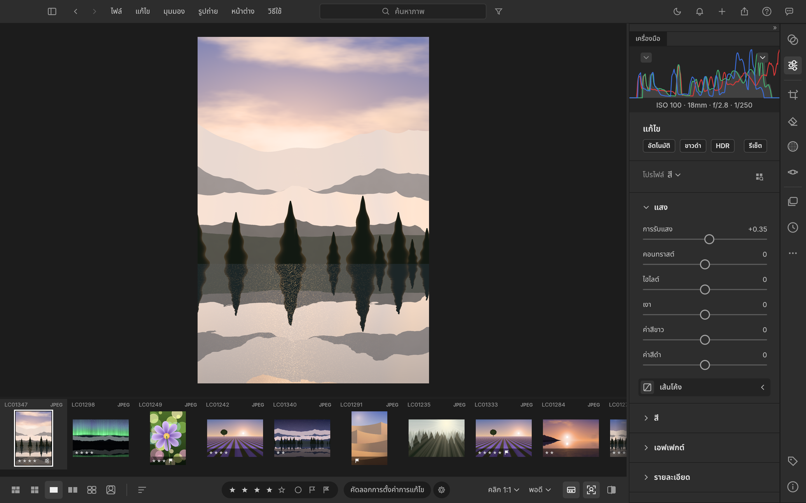
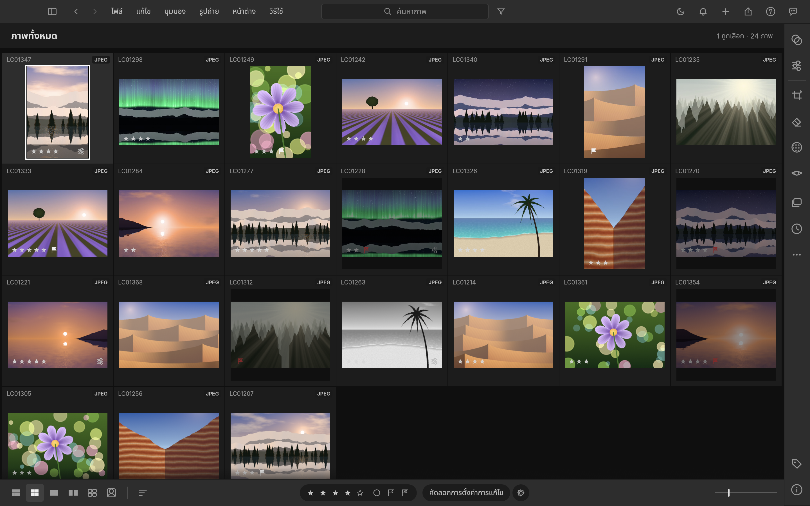

# LightCraft TH

LightCraft รุ่นภาษาไทย สำหรับจัดคลังภาพ คัดภาพ และปรับแต่งภาพแบบไม่แก้ต้นฉบับ ต่อยอดจาก [storytold/lightcraft](https://github.com/storytold/lightcraft) โดย Tapanapon / One Per Craft

รุ่นไทย **0.20.0-th.1** ใช้ซอร์สต้นฉบับ **v0.20.0** ที่ commit [`192ff72`](https://github.com/storytold/lightcraft/tree/192ff72923c39e6623f2c7ff67ab3a119deb8071) เป็นฐาน ซอร์สแอปจริงอยู่ใน repository นี้ รุ่นนี้เป็น prerelease และยังอยู่ในระยะ alpha ตามต้นฉบับ

## ภาพหน้าจอจากแอปไทยจริง

ภาพจากแพ็กเกจ Mac ที่ตรวจแล้ว ใช้คลังภาพสาธิตสังเคราะห์ของแอป ไม่ใช้ภาพส่วนตัว





[ภาพการตั้งค่า](docs/images/thai/lightcraft-th-settings.png) · [บันทึกการถ่ายภาพและผลตรวจ](docs/images/thai/capture-0.20.0-th.1.json)

## ดาวน์โหลดและติดตั้ง

ไฟล์ติดตั้งอยู่ใน **[Releases → v0.20.0-th.1](https://github.com/tapanapon-com/lightcraft-th/releases/tag/v0.20.0-th.1) → Assets** ต้องขยาย Assets เพื่อดูไฟล์ ไม่ใช้ปุ่ม Code → Download ZIP สำหรับติดตั้ง

| ระบบ | ไฟล์ที่เลือก |
| --- | --- |
| Mac Apple Silicon (M-series), macOS 11 ขึ้นไป | `lightcraft-0.20.0-th.1-macos-aarch64.dmg` |
| Windows x64 | `lightcraft-0.20.0-th.1-windows-x64.msi` |
| Windows x64 แบบไม่ติดตั้ง | `lightcraft-0.20.0-th.1-windows-x64-portable.zip` |

รุ่นไทยนี้ยังไม่มีแพ็กเกจ Mac Intel หรือ Windows ARM64 ที่ตรวจยืนยัน ใช้ไฟล์ตรงกับเครื่องของคุณ

### Mac

1. ตรวจ Apple menu → About This Mac ว่า Chip เป็น Apple M-series
2. ดาวน์โหลด DMG และไฟล์ `.sha256` ชื่อเดียวกันจาก Assets ของรุ่นนี้
3. เปิด DMG แล้วลาก **LightCraft.app** เข้า **Applications** ปิดแอปรุ่นเดิมก่อนแทนที่
4. Eject ดิสก์ติดตั้ง แล้วเปิด LightCraft จาก Applications
5. โปรไฟล์ใหม่เริ่มภาษาไทย หากเคยเลือกภาษาอื่นไว้ ให้เปิด **Edit → Language → ไทย** หรือ **Settings → Language → ไทย**

แพ็กเกจ Mac ใช้ลายเซ็น ad-hoc และยังไม่ผ่าน Apple notarization หากระบบปฏิเสธการเปิด ให้ตรวจไฟล์และ SHA-256 แล้วทำตามตัวเลือกที่ macOS แสดงใน Privacy & Security สำหรับแอปที่คุณตรวจแล้ว ไม่ปิด Gatekeeper ทั้งระบบ

ตรวจ hash โดยเปลี่ยนพาธให้ตรงไฟล์ที่ดาวน์โหลด:

```sh
shasum -a 256 ~/Downloads/lightcraft-0.20.0-th.1-macos-aarch64.dmg
```

### Windows

1. เปิด Settings → System → About ตรวจว่าเป็นเครื่อง x64
2. ดาวน์โหลด MSI และ `SHA256SUMS-windows-x64.txt` จาก Assets รุ่นเดียวกัน
3. เปิด MSI เลือกขอบเขตผู้ใช้และโฟลเดอร์ติดตั้งตามหน้าจอ แล้วเปิด LightCraft จาก Start
4. ถ้าใช้ Portable ให้แตก ZIP **ทั้งหมด** ไปยังโฟลเดอร์ใหม่ แล้วเปิด `lightcraft.exe` เก็บ `lightcraft-cli.exe` และไฟล์ประกอบไว้ด้วยกัน
5. เลือกไทยใน **Edit → Language** หรือ **Settings → Language** หากมีการตั้งค่าภาษาเดิม

แพ็กเกจ Windows ยังไม่มีลายเซ็นดิจิทัล หาก SmartScreen เตือน ให้ตรวจแหล่งดาวน์โหลดและ hash ก่อนทำตามตัวเลือกที่เครื่องอนุญาต

```powershell
Get-FileHash -Algorithm SHA256 "$env:USERPROFILE\Downloads\lightcraft-0.20.0-th.1-windows-x64.msi"
```

### อัปเดตและใช้ซอร์สจาก GitHub

รุ่น `-th.1` ใช้ดาวน์โหลดอัปเดตด้วยตนเองจาก Releases ตัวตรวจอัปเดตของต้นฉบับไม่เสนอ prerelease นี้ ปิดแอปและสำรองคลังภาพก่อนเปลี่ยนรุ่น สำหรับ Portable ให้แตกลงโฟลเดอร์ใหม่

**Source code (zip/tar.gz)**, **Code → Download ZIP** และ `git clone` เป็นซอร์ส ต้องติดตั้ง Rust และ build ก่อน ดู [คู่มือติดตั้งจากซอร์สและ MCP](docs/localization-th.md) หากต้องการใช้งานทันที ให้เลือก DMG/MSI/Portable

## ภาษาไทยและผลตรวจ

แค็ตตาล็อกมีข้อความทั่วไป 3,844 รายการ และรูปแบบข้อความ 336 รายการ รวม **4,180 รายการ** ชื่อไฟล์ ข้อมูลผู้ใช้ และรหัสเทคนิคคงรูปเดิม ข้อความวินิจฉัยจากเอนจินและบันทึกย้อนหลังใน What’s New บางส่วนยังเป็นอังกฤษ มีการใช้ร่างแปลช่วยด้วยเครื่องมือและปรับศัพท์/ตัวเลข/ตัวแปร ยังไม่ได้อ้างว่ามีผู้ตรวจภาษาทุกประโยคอย่างอิสระ

ดู [Version Log](docs/version-log.md) และผลตรวจรุ่นนี้ก่อนใช้งานจริง การรองรับ RAW ขึ้นอยู่กับกล้องและชนิดการบีบอัด ไม่ได้เทียบเท่าความสามารถทั้งหมดของ Lightroom

## เชื่อม Codex หรือ Claude

แพ็กเกจ Mac มี CLI ใน `LightCraft.app/Contents/MacOS/lightcraft-cli` ส่วน Windows มี `lightcraft-cli.exe` ข้างโปรแกรม ดูตัวอย่างแบบ headless และเชื่อมหน้าต่างแอปใน [คู่มือ MCP ภาษาไทย](docs/localization-th.md)

## ต้นฉบับและสัญญาอนุญาต

- [ซอร์สต้นฉบับ](https://github.com/storytold/lightcraft) · [Release Notes v0.20.0](https://github.com/storytold/lightcraft/releases/tag/v0.20.0)
- เอนจินและความสามารถหลักเป็นผลงานของผู้พัฒนาต้นฉบับ รุ่นไทยเป็นงานแปลอิสระ ไม่ใช่รุ่นที่รับรองโดยผู้สร้าง ArtCraft
- คง [MIT](LICENSE-MIT), [Apache-2.0](LICENSE-APACHE), [NOTICE](NOTICE), [เครดิตทรัพยากร](assets/ATTRIBUTION.md) และสัญญาอนุญาตฟอนต์ไว้
- เอกสารต้นฉบับ: [README-upstream.md](README-upstream.md)

## English

LightCraft TH is an independent Thai localization based on the complete upstream v0.20.0 source. Download the Apple Silicon DMG or Windows x64 MSI/portable ZIP from the tagged prerelease's **Assets**. Source archives require a build. New profiles default to Thai; existing language preferences are retained. The Mac bundle includes the CLI for MCP clients. Mac packages are ad-hoc signed without Apple notarization; Windows packages are unsigned. See the version log and validation report for the exact tested scope. Core application work belongs to the upstream contributors and its original licenses remain intact.
